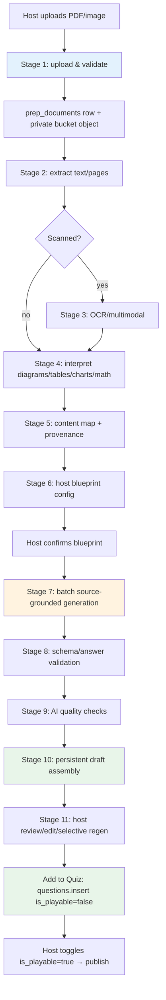

# Brain Bolt — AI Quiz Preparation: Proposed Architecture & Data Flow

> Scope: upload PDFs/images → understand material → generate source-grounded, reviewed, playable quizzes. Smallest reliable path. No embeddings, no marketplace, no collaborative editing, no unrelated AI.

Built on the Phase 8E/8F AI foundation (`BrainBoltAiService`, `AiProvider`, `validateQuiz`, `public.can()`, `ai_usage_log`). Reuses existing abstractions; adds only what the prep pipeline requires.

---

## 1. Trust boundary (text-only, server-side)

```
Browser
  │ (Authorization: Bearer <jwt>)
  ▼
TanStack Start server function (Nitro / Cloudflare Worker)
  │ requireSupabaseAuth middleware  →  userId + supabase client
  ▼
supabase.rpc("can", { p_action: "ai.prep_<stage>", p_resource: <docId|quizId> })
  ▼
Prep pipeline server fn (short, stateless; client-polling drives stages)
  ▼
Task-based Bedrock model router  →  AWS Bedrock (text + multimodal models)
  ▼
extractJsonObject + validateQuiz (canonical questionSchema)
  ▼
recordUsage → ai_usage_log (service_role only)
  ▼
Persist stage result → prep_jobs / prep_job_stages / prep_sources
  ▼
Typed envelope → browser (client polls for next stage)
```

Provider names, model IDs, AWS keys, and regions are **never** exposed to the browser. The browser sees only friendly messages from `FRIENDLY_MESSAGES` and stage status/progress.

All Bedrock calls are server-side. The client never holds AWS credentials and never calls Bedrock directly.

---

## 2. Core entities

| Entity | Purpose | Key fields |
|---|---|---|
| `prep_documents` | One uploaded source document (PDF/image), owner-scoped | id, owner_principal_id, bucket, object_key, mime_type, size_bytes, page_count, status (uploaded/extracting/extracted/failed), version (int, increments on re-upload), created_at |
| `prep_jobs` | One preparation run (document → quiz draft), resumable | id, document_id, quiz_id (nullable, target quiz), owner_principal_id, status, current_stage, progress_pct, error, created_at, updated_at, completed_at, cancelled_at |
| `prep_job_stages` | One stage attempt within a job | id, job_id, stage (enum), status, attempt, input_summary, output_summary, error, started_at, finished_at, retry_count |
| `prep_sources` | Provenance: a generated question's source anchor | id, job_id, question_index, document_id, version, page, section, excerpt (text), confidence |
| `prep_drafts` | Assembled host-reviewable draft (linked to a job) | id, job_id, quiz_id, title, questions (JSON, canonical shape), status (pending_review/approved/rejected), created_at |

---

## 3. Staged pipeline — inputs, outputs, failure modes, persistence, retry

The pipeline is **client-polling driven**: each stage is a short server fn. The client triggers stage N+1 only after stage N persists success. This fits Cloudflare Workers (no long-running request) and makes every stage resumable.

### Stage 1 — Secure document upload & validation

**Inputs:** File (PDF or image), quiz_id (optional target), owner principal (from JWT).
**Server-side validation:** mime type ∈ {pdf, png, jpg, jpeg, webp}; size ≤ cap (e.g. 25 MB); page_count ≤ cap (e.g. 200 for PDF); filename sanitized; object stored under `owner_principal_id/{jobId}/` prefix.
**Outputs:** `prep_documents` row (status=uploaded), object in private bucket `quiz-prep-documents`, signed URL (short-lived) for server-side processing only.
**Failure modes:** unsupported type, over size/pages, upload failure, storage quota. Return `validation_failed`/`over_limit` friendly message.
**Persistence:** `prep_documents` row + object. Retry: client re-uploads; no partial state.

### Stage 2 — PDF text extraction & page-structure preservation

**Inputs:** document_id, version.
**Processing:** Server extracts text per page + page count + reading order (headings/blocks) using a server-side PDF library (text-based PDFs). Preserves page numbers as provenance anchors.
**Outputs:** `prep_job_stages` row (stage=document_extract) with per-page text + page map; `prep_documents.status=extracted`.
**Failure modes:** encrypted/corrupt PDF, no extractable text (scanned), library timeout. On scanned/NoText → route to Stage 3 (OCR/multimodal) and flag `needs_ocr`.
**Persistence:** stage row + extracted text stored with the job (not re-extracted on retry).
**Retry:** idempotent — re-extraction overwrites stage output; retry up to N on transient failure.

### Stage 3 — OCR / multimodal for scanned PDFs & images

**Inputs:** document pages/images, `needs_ocr` flag.
**Processing:** Multimodal Bedrock model renders each page/image and returns OCR text + layout hints. For image uploads (single page), one multimodal call.
**Outputs:** OCR'd text per page; stage row `document_ocr`; confidence per page (low-confidence pages flagged to host).
**Failure modes:** model timeout/rate limit, unreadable page. Low confidence → warning, not error; host must review.
**Persistence:** stage row + OCR text. Retry: per-page, only failed pages retried.
**Retry:** exponential backoff, capped; partial OCR preserved.

### Stage 4 — Interpretation of diagrams, tables, charts, math

**Inputs:** pages flagged as containing non-text (from stage 2/3 layout hints) or host-selected pages.
**Processing:** Multimodal model describes each diagram/table/chart/math block in text (alt-text + structure). Math → LaTeX-ish text. Tables → markdown/JSON structure.
**Outputs:** stage row `media_interpretation` with per-block description + page anchor.
**Failure modes:** model misreads a chart, unreadable math. Flagged as uncertainty to host.
**Persistence:** stage row + block descriptions. Retry: per-block.

### Stage 5 — Structured content mapping with page/section provenance

**Inputs:** extracted/OCR'd text + interpretations + page map.
**Processing:** Deterministic code chunks content into sections (by headings/page breaks). Each chunk gets `document_id`, `version`, `page`, `section`, `excerpt`. No LLM needed for chunking — it's rule-based (page breaks + heading detection).
**Outputs:** `prep_sources` rows (provenance anchors) + `prep_job_stages` row `content_map`.
**Failure modes:** none deterministic; empty document → validation error.
**Persistence:** `prep_sources` + stage row. Idempotent re-map.

### Stage 6 — Host configuration & quiz blueprint planning

**Inputs:** content map, host preferences (topic focus, question types, count, difficulty, pages to include/exclude).
**Processing:** Server validates host selection against `prep_sources` (only included pages feed generation). Returns a blueprint: which sections → how many questions of which types.
**Outputs:** `prep_job_stages` row `host_blueprint` (host-editable). Job status waits for host confirmation.
**Failure modes:** host selects zero pages → validation error.
**Persistence:** stage row; host can revise before confirming.
**Retry:** n/a (user-driven).

### Stage 7 — Source-grounded question generation in batches

**Inputs:** blueprint (sections, types, count), source excerpts with page anchors, existing question texts (de-dup).
**Processing:** For each batch, `generateQuestions` variant is called with a prompt that includes source excerpts and instructs the model to cite page/section per question. Model output mapped to canonical `BrainBoltQuestion` + linked `prep_sources`.
**Outputs:** batch of drafted questions, each with provenance (document_id, version, page, section, excerpt). Stage row `question_generate` per batch.
**Failure modes:** invalid_output, validation_failed, provider timeout/rate limit, count mismatch. Failed batch → retry that batch only; other batches keep their results.
**Persistence:** stage rows + draft questions attached to `prep_jobs`/draft. Partial success preserved — a page refresh does not lose completed batches.
**Retry:** per-batch, exponential backoff, capped. Cross-check with a different model for quality (stage 8) is NOT treated as proof of correctness.

### Stage 8 — Deterministic schema & answer validation

**Inputs:** generated draft questions.
**Processing:** `validateQuiz` (canonical schema + semantic rules). Deterministic checks: answer key present, distractors distinct, type-specific config (map_pin lat/lng in range, number correctNumber in [min,max], ordering items unique, type acceptedAnswers non-empty).
**Outputs:** pass/fail per question; `prep_job_stages` row `validate`. Failures feed stage 9 (selective regen).
**Failure modes:** deterministic — no retry, just reporting. Warnings distinguished from errors.
**Persistence:** validation result stored with the stage.

### Stage 9 — AI-assisted source-support, ambiguity, duplicate, quality checks

**Inputs:** validated questions + source excerpts.
**Processing:** Separate model (router-picked, different from generation model) checks each question: (a) is the answer supported by the cited excerpt? (b) is the question ambiguous? (c) is it a near-duplicate of another question or an existing quiz question? (d) quality score. Outputs warnings, not hard errors (per §4 of brief — distinguish warnings from confirmed errors).
**Outputs:** per-question flags + confidence; stage row `quality_review`.
**Failure modes:** model unavailable → degrade gracefully (skip AI checks, mark `review_required`); host must review.
**Persistence:** stage row + flags. Not treated as proof of correctness — two models agreeing ≠ correct.

### Stage 10 — Persistent draft assembly & quiz persistence

**Inputs:** passed questions + provenance.
**Processing:** Assemble `prep_drafts` row (questions in canonical shape + `prep_sources` links). Draft is server-persisted (survives refresh). Host can then "Add to Quiz" → insert via existing `supabase.from('questions').insert(...)` with `is_playable=false`, using `questionToDbRow`.
**Outputs:** `prep_drafts` row; optionally inserted question rows.
**Failure modes:** insert conflict (rare, no UNIQUE on position) → guarded by client ref (existing pattern in panel).
**Persistence:** `prep_drafts` + question rows. Resumable.

### Stage 11 — Host review, editing, selective regeneration, participant preview

**Inputs:** `prep_drafts` row.
**UI:** Host reviews each question with its source excerpt + page citation. Controls: edit text, regenerate one question (same type, re-grounded in same source), exclude, reorder. Preview as participant (read-only, non-playable).
**Outputs:** Approved questions inserted into `questions` table (`is_playable=false` by default); `prep_drafts.status=approved`.
**Failure modes:** host aborts → draft stays `pending_review`, resumable.
**Persistence:** draft + inserted rows. Host approval required before publication/hosting — AI never auto-publishes.

---

## 4. Data flow diagram (mermaid)



All stage results persist to `prep_job_stages`; `prep_jobs.current_stage` / `progress_pct` drive the client poll UI.

---

## 5. Error & retry principles

- **Never lose successful work:** each stage persists before the next starts. A page refresh, model failure, or failed batch only affects the in-flight stage.
- **Retry per-stage / per-batch, never restart the whole pipeline.** `prep_job_stages.attempt` + `retry_count` bound retries (exponential backoff, capped).
- **Warnings ≠ errors:** `validateQuiz` returns both. Schema/answer violations are errors (block); ambiguity/duplicate/low-confidence are warnings (host decides).
- **Host approval is a hard gate:** AI never writes `is_playable=true` or publishes. The existing `is_playable=false` default + editor toggle is the enforcement point.
- **No model agreement as proof:** stage 9 uses a different model for cross-check, but its output is advisory only.
